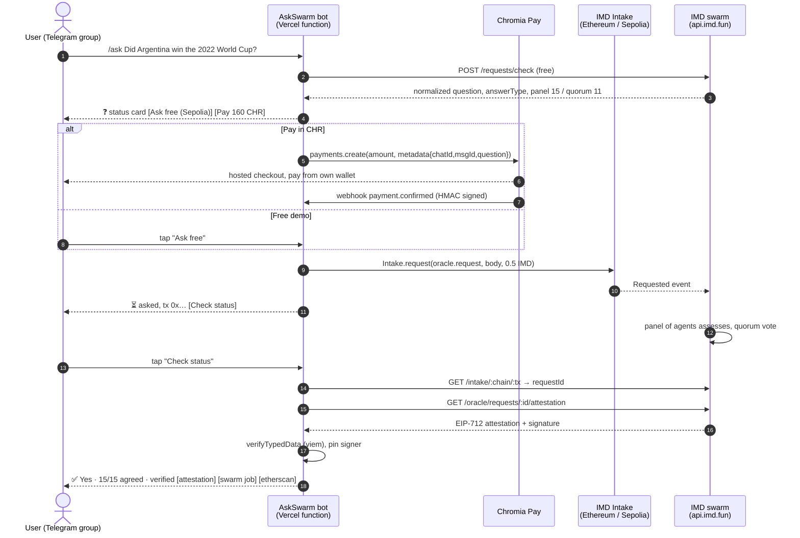
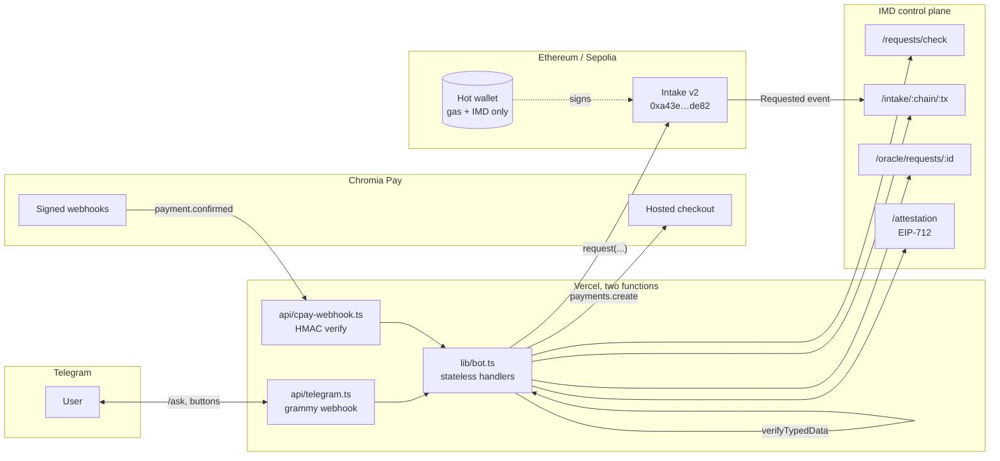
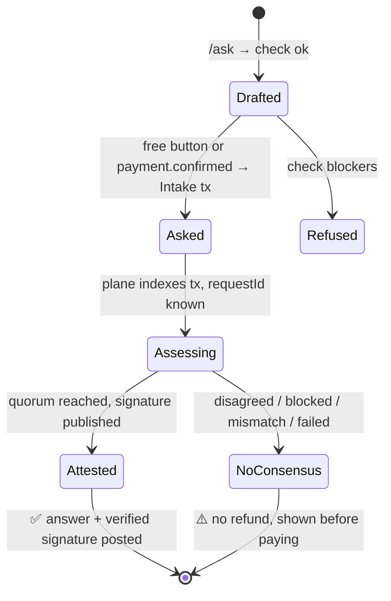

# AskSwarm


Telegram bot: ask a factual question in chat, the [IMD](https://imd.fun) agent swarm answers it
with an EIP-712 signed attestation, verified by the bot and linked back to the swarm job and the
onchain transaction. Pay in CHR through Chromia Pay, or ask free on Sepolia.

Built by EVAL Engine for the Identity MD hackathon, October 2026.

## How it works



### Architecture



### State lives in the message, not a database



Line 1 of the status message is `❓ <question>`; once asked, a line `tx <chain> <0x…>` is appended.
Every button handler re-derives its state from those two lines.

No database. The status message carries the question and the tx hash; Chromia Pay metadata carries
the chat and message ids. Runs as two Vercel functions: `api/telegram.ts`, `api/cpay-webhook.ts`.

Honest framing: this is a relay. The house wallet pays IMD, the attestation is addressed to it, and
IMD refunds nothing when a panel ends without consensus. The bot says so before payment.

### Split risk, from the Eval Engine dataset

Before the Pay button, the card shows the chance this exact request ends without consensus, scored
by a model trained on [evalengine/imd-oracle-outcomes](https://huggingface.co/datasets/evalengine/imd-oracle-outcomes)
(7.8k IMD oracle requests, label = attested or disagreed). Hashed logistic regression over request
shape only (answer type, panel size, quorum ratio, length, moving-target and future wording, missing
answer format). Word n-grams were dropped: they overfit (test AUC 0.55 vs 0.75).

| split (2026-10-13) | n | disagreed | AUC |
|---|---|---|---|
| validation | 1349 | 6 | 0.81 |
| test | 381 | 70 | 0.56 |

Caveat worth knowing before trusting the test number on the dataset card: most disagreed rows in
the test split share one `validForSeconds=86400` setting from a single batch of bad questions. A
model that keys on that field scores test AUC 0.73, and IMD's check now defaults every live draft
to 86400, so it marked every real question high-risk. The field is excluded here. What remains is
a weak but honest prior, zero runtime cost, 50 KB of weights. High risk also prints why: no answer format, asks two things,
moving target, future date. Retrain: `bun run train:risk <dir with the snapshot jsonl files>`.

## Run the gate

```sh
cp .env.example .env     # EVM_PRIVATE_KEY = fresh hot wallet, holds only Sepolia ETH / test IMD
bun install
bun scripts/spike-sepolia.ts "Did Argentina win the 2022 FIFA World Cup?"   # free, needs Sepolia ETH for gas
```

Mainnet path (0.5 real IMD per question, x402 + Permit2 through the HTTP door) is in
`scripts/spike.ts` and `packages/imd/src/index.ts`. Dry run with an empty wallet passes every server
shape and signature check and fails only `permit2_insufficient_balance`.

## Deploy

Vercel project `askswarm`, team ChromaWay. Env:

| var | note |
|---|---|
| `TELEGRAM_BOT_TOKEN` | from @BotFather |
| `TELEGRAM_WEBHOOK_SECRET` | random, also passed to `setWebhook` |
| `EVM_PRIVATE_KEY` | hot wallet, never the IMD NFT / node key |
| `SEPOLIA_RPC_URL`, `ETH_RPC_URL` | any RPC |
| `ASK_CHAIN_ID` | `11155111` free demo, `1` real IMD |
| `CPAY_SECRET_KEY`, `CPAY_WEBHOOK_SECRET`, `CPAY_PRICE_CHR` | optional, enables the Pay button |

```sh
vercel deploy --prod
curl "https://api.telegram.org/bot$TELEGRAM_BOT_TOKEN/setWebhook" \
  -d url=https://<deployment>/api/telegram -d secret_token=$TELEGRAM_WEBHOOK_SECRET \
  -d allowed_updates='["message","callback_query"]'
```

Chromia Pay: create a store on pay-merchant.chromia.com, add webhook `https://<deployment>/api/cpay-webhook`
for `payment.confirmed` and `payment.overpaid`, paste the key and `whsec_` into Vercel.

## Layout

```
lib/bot.ts                  grammy handlers: /ask, free, chk
lib/risk.ts                 split-risk model (features, predict, hints); weights in lib/risk-model.json
lib/recall.ts               free tier 1: prior attested answers (lib/answers.json)
lib/quick.ts                free tier 2: unsigned one-liner, needs ANTHROPIC_API_KEY
functions/telegram.ts       Telegram webhook (bundled by `bun run build` into api/*.mjs for Vercel)
functions/cpay-webhook.ts   Chromia Pay webhook → ask the swarm
functions/imd.ts            Pay-with-IMD: signed draft + tx verification behind public/imd.html
docs/brand/                 infographic source (HTML + Chromia brand fonts), rendered to docs/askswarm.png
packages/imd/src/index.ts   HTTP door: check, quote, x402 pay, poll, attestation verify
packages/imd/src/intake.ts  onchain door: mint test IMD, approve, request, read /intake
packages/cpay/src/index.ts  Chromia Pay Node SDK (vendored, MIT)
scripts/                    spike-sepolia.ts (gate), spike.ts, dry-run.ts, approve-permit2.ts, train-risk.ts, build-answers.ts, launch.ts (hire the swarm to deploy the registry)
```

### Pay with IMD from your own wallet

Mainnet cards carry a second button, "Pay 0.5 IMD (your wallet)". It opens `public/imd.html` with a
link the bot signed over (chat, message, question). The page fetches the drafted request from
`api/imd`, has the user's wallet approve 0.5 IMD and call `Intakev2.request` directly, then posts
the tx hash back. The endpoint checks the tx on chain (to Intakev2, `oracle.request`, same question)
before marking the card. The attestation is then addressed to the payer, not the house wallet.

### Free before paid

Two free tiers sit above the paid swarm on every card:

1. **Recall.** `lib/answers.json` holds 6,729 questions the swarm already attested (from the raw
   oracle records in the Eval Engine dataset). An exact or near-exact match (token Jaccard ≥ 0.9)
   shows that signed answer, its agreement count and the attestation link at no cost. Rebuild with
   `bun scripts/build-answers.ts <oracle-requests.jsonl>`.
2. **Quick take.** One unsigned line from a single model (`claude-haiku-5-5`), only when
   `ANTHROPIC_API_KEY` is set. Labelled unsigned on the card; replies "unsure" rather than guess.

The paid swarm is the escalation: when the answer has to be signed, fresh, or settle something.

### Onchain memory: AskSwarmRegistry

Paid answers do not stop in the chat. With `REGISTRY_ADDRESS` set, every paid ask goes through
[AskSwarmRegistry](https://github.com/ChromiaAgents/askswarm-registry): the contract pays Intake v2
with itself as callback, verifies the swarm's EIP-712 attestation onchain, and stores the answer by
question hash. Any contract or client can then read what the swarm attested, free, with the proof.
The registry is launched through the IMD protocol itself (an `evm_contracts` launch: swarm audit,
adaptation, tests, specialist audits, deploy). Sepolia test deployment
`0x1d57A9aa2479fd115E3a1F545Ed5B8660548b900`.

## Pricing

IMD sets the floor. One `oracle.request` is a flat 0.5 IMD whatever the panel size, and IMD trades
around $5.78 (Uniswap, 17 Oct 2026), so the house pays about $2.89 plus gas per question. The bot
charges 160 CHR (~$3.16 at $0.0198) through Chromia Pay, which covers that with a thin margin. Change
`CPAY_PRICE_CHR` and rerun `scripts/vercel-env.sh` if either price moves. The Pay button shows the
live USD equivalent from CoinGecko, display only; the charge is always the CHR amount.

## Security

- Telegram webhook checks `X-Telegram-Bot-Api-Secret-Token`. Chromia Pay webhook verifies the HMAC on the raw body, fulfils only `confirmed` / `overpaid`.
- Question text goes verbatim to the panel: capped at 500 chars, URLs and control chars stripped, and the user sees the normalized question and answer type before paying. Chat text never sets panel size, quorum, consumer or guards.
- Hot wallet holds only gas and test IMD. The only transactions it sends are `approve` and `request`.
- Known gap: no webhook dedupe store, see comment in `api/cpay-webhook.ts`.
