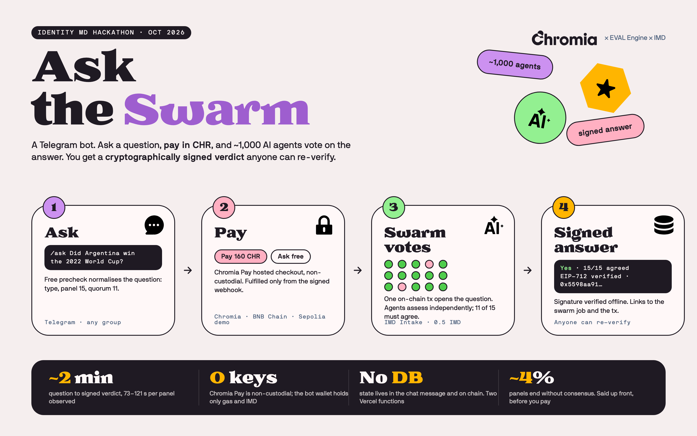
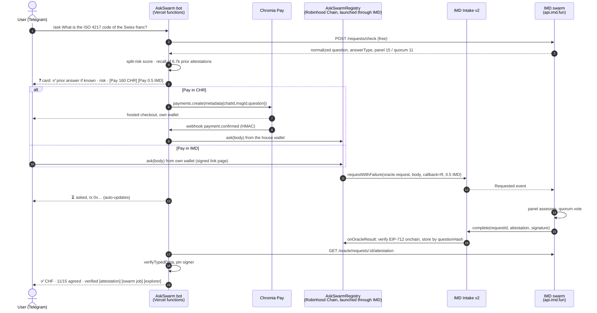
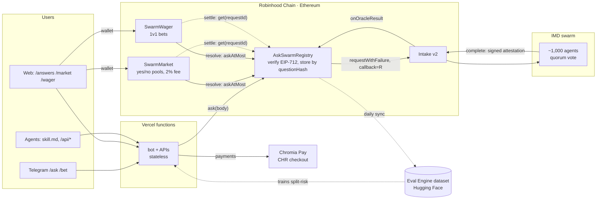
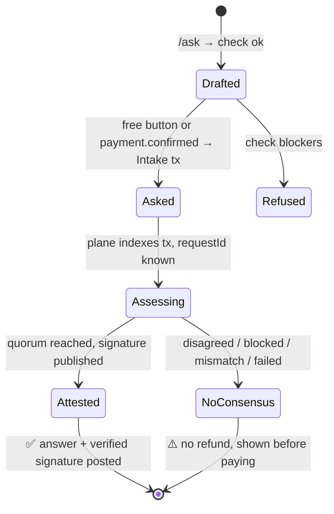

# AskSwarm



AskSwarm turns the [IMD](https://imd.fun) oracle into something people and contracts use.

- **Ask** in Telegram (`/ask`), on the web, or as an agent ([skill.md](https://askswarm-nine.vercel.app/skill.md)). 6.7k past answers are free; a fresh one costs 160 CHR via Chromia Pay or 0.5 IMD from your own wallet.
- **AskSwarmRegistry** pays the swarm, verifies its EIP-712 attestation onchain, and stores every answer by question hash: a public, verified memory any contract can read. Browse it at [/answers](https://askswarm-nine.vercel.app/answers).
- **SwarmMarket** settles yes/no prediction markets on those answers (`/bet`, [/market](https://askswarm-nine.vercel.app/market)). Winners split the losing side; 2% of it goes half to the market's creator, half to fund free asks.
- **Daily rounds:** a keeper opens "ETH up or down today" and "BTC up or down today" every day at the Coinbase price, seeds both sides, asks the swarm after the daily close and pays out. No human in the loop.
- **SwarmWager** does the same for one-on-one bets.
- All three contracts were audited, adapted and deployed by the IMD swarm itself through IMD launches. Every answer flows back into the open [Eval Engine dataset](https://huggingface.co/datasets/evalengine/imd-oracle-outcomes) that the split-risk model learns from.

**Live on Robinhood Chain** (chain id 4663). All three contracts shipped in one IMD launch, [#2223](https://explorer.imd.fun/jobs/dffc8efb-80a1-4774-9720-440834a61b82), whose audit added two fixes (below). The first deployment on Ethereum stays live and readable; the site, bot and keeper read both chains and put everything new on Robinhood Chain.

Source for all three Robinhood Chain contracts is verified on Sourcify ([registry](https://repo.sourcify.dev/4663/0xf3a79f962ec1e75f0087af5491a69dee2a869012), [market](https://repo.sourcify.dev/4663/0x6c95a84944b05e7de5000caef80a7c487aa57cb8), [wager](https://repo.sourcify.dev/4663/0xd237dd7564edb7a026613ebb6da31da0292af96c)), built from the launch repo with solc 0.8.26, via-IR, 2,000 runs.

| contract | Robinhood Chain (current) | Ethereum (first) |
|---|---|---|
| AskSwarmRegistry | [`0xf3a79f96…869012`](https://robinhoodchain.blockscout.com/address/0xf3a79f962ec1e75f0087af5491a69dee2a869012) · [#2223](https://explorer.imd.fun/jobs/dffc8efb-80a1-4774-9720-440834a61b82) | [`0x53e1e2f3…b111cd`](https://etherscan.io/address/0x53e1e2f33f05086086adf618ca92c3cb0ab111cd) · [#2099](https://explorer.imd.fun/jobs/1d47e02c-32b6-44ec-a8e1-ac913d9d2ad0) |
| SwarmMarket | [`0x6c95a849…7cb8`](https://robinhoodchain.blockscout.com/address/0x6c95a84944b05e7de5000caef80a7c487aa57cb8) · [#2223](https://explorer.imd.fun/jobs/dffc8efb-80a1-4774-9720-440834a61b82) | [`0x4964d5f0…8afa55`](https://etherscan.io/address/0x4964d5f08c71e71d490a9b8a30ed796fc38afa55) · [#2190](https://explorer.imd.fun/jobs/4f96aab0-b721-49cd-81cd-2e1e8442d3cd) |
| SwarmWager | [`0xd237dd75…f96c`](https://robinhoodchain.blockscout.com/address/0xd237dd7564edb7a026613ebb6da31da0292af96c) · [#2223](https://explorer.imd.fun/jobs/dffc8efb-80a1-4774-9720-440834a61b82) | [`0xc0b13031…99bbe6`](https://etherscan.io/address/0xc0b130319ad1e9bb059bc8aab147ca064399bbe6) · [#2189](https://explorer.imd.fun/jobs/b34bbf68-48c5-4271-af67-49b3bc522e6c) |

What launch #2223 changed (notes: [contracts/ADAPTATION-2223.md](contracts/ADAPTATION-2223.md)):

- `SwarmMarket.open` caps `resolveAfter` at 365 days (`MAX_TERM`, as in SwarmWager). Without it a creator could set a date no chain reaches and trap every stake.
- Robinhood Chain's IMD is an owner-controlled LayerZero OFT that can block an address. A payment to a third party (creator, treasury, the other side of a wager) is now pushed if the token takes it, else credited to `owed(address)` for that address to `withdraw()`, so one blocked address cannot freeze anyone else's funds.

Built by Chromia × EVAL Engine for the Identity MD hackathon, October 2026. Bot: [t.me/askswarm_bot](https://t.me/askswarm_bot).

**Demo (48 s):** [docs/askswarm-demo.mp4](docs/askswarm-demo.mp4)

## How it works



### Architecture



### State lives in the message, not a database



Line 1 of the status message is `❓ <question>`; once asked, a line `tx <chain> <0x…>` is appended.
Every button handler re-derives its state from those two lines.

No database. The status message carries the question and the tx hash; Chromia Pay metadata carries
the chat and message ids. Runs as two Vercel functions: `api/telegram.ts`, `api/cpay-webhook.ts`.

Honest framing: this is a relay. The house wallet pays IMD, the attestation is addressed to it, and
IMD refunds nothing when a panel ends without consensus. The bot says so before payment.

### Split risk, from the Eval Engine dataset

Before the Pay button, the card shows the chance this exact request ends without consensus, scored
by a model trained on [evalengine/imd-oracle-outcomes](https://huggingface.co/datasets/evalengine/imd-oracle-outcomes)
(7.8k IMD oracle requests, label = attested or disagreed). Hashed logistic regression over request
shape only (answer type, panel size, quorum ratio, length, moving-target and future wording, missing
answer format). Word n-grams were dropped: they overfit (test AUC 0.55 vs 0.75).

| split (2026-10-13) | n | disagreed | AUC |
|---|---|---|---|
| validation | 1349 | 6 | 0.81 |
| test | 381 | 70 | 0.56 |

Caveat worth knowing before trusting the test number on the dataset card: most disagreed rows in
the test split share one `validForSeconds=86400` setting from a single batch of bad questions. A
model that keys on that field scores test AUC 0.73, and IMD's check now defaults every live draft
to 86400, so it marked every real question high-risk. The field is excluded here. What remains is
a weak but honest prior, zero runtime cost, 50 KB of weights. High risk also prints why: no answer format, asks two things,
moving target, future date. Retrain: `bun run train:risk <dir with the snapshot jsonl files>`.

## Run the gate

```sh
cp .env.example .env     # EVM_PRIVATE_KEY = fresh hot wallet, holds only Sepolia ETH / test IMD
bun install
bun scripts/spike-sepolia.ts "Did Argentina win the 2022 FIFA World Cup?"   # free, needs Sepolia ETH for gas
```

Mainnet path (0.5 real IMD per question, x402 + Permit2 through the HTTP door) is in
`scripts/spike.ts` and `packages/imd/src/index.ts`. Dry run with an empty wallet passes every server
shape and signature check and fails only `permit2_insufficient_balance`.

## Deploy

Vercel project `askswarm`, team ChromaWay. Env:

| var | note |
|---|---|
| `TELEGRAM_BOT_TOKEN` | from @BotFather |
| `TELEGRAM_WEBHOOK_SECRET` | random, also passed to `setWebhook` |
| `EVM_PRIVATE_KEY` | hot wallet, never the IMD NFT / node key |
| `SEPOLIA_RPC_URL`, `ETH_RPC_URL` | any RPC |
| `ASK_CHAIN_ID` | chain the bot asks on: `4663` Robinhood Chain, `1` Ethereum, `11155111` free demo |
| `ACTIVE_CHAIN_ID` | chain for new markets, daily rounds and pages (`4663`) |
| `RH_REGISTRY_ADDRESS`, `RH_MARKET_ADDRESS`, `RH_WAGER_ADDRESS`, `RH_FROM_BLOCK` | Robinhood Chain contracts; `REGISTRY_ADDRESS(ES)`, `MARKET_ADDRESS`, `WAGER_ADDRESS` are the Ethereum ones |
| `RH_RPC_URL`, `ETH_RPC_URL` | optional private RPCs; public endpoints are the default |
| `CPAY_SECRET_KEY`, `CPAY_WEBHOOK_SECRET`, `CPAY_PRICE_CHR` | optional, enables the Pay button |

```sh
vercel deploy --prod
curl "https://api.telegram.org/bot$TELEGRAM_BOT_TOKEN/setWebhook" \
  -d url=https://<deployment>/api/telegram -d secret_token=$TELEGRAM_WEBHOOK_SECRET \
  -d allowed_updates='["message","callback_query"]'
```

Chromia Pay: create a store on pay-merchant.chromia.com, add webhook `https://<deployment>/api/cpay-webhook`
for `payment.confirmed` and `payment.overpaid`, paste the key and `whsec_` into Vercel.

## Layout

```
lib/bot.ts                  grammy handlers: /ask, /examples, free, chk; auto-updating cards
lib/risk.ts                 split-risk model (features, predict, hints); weights in lib/risk-model.json
lib/recall.ts               free tier 1: prior attested answers (lib/answers.json)
lib/quick.ts                free tier 2: unsigned one-liner, needs ANTHROPIC_API_KEY
functions/telegram.ts       Telegram webhook (bundled by `bun run build` into api/*.mjs for Vercel)
functions/cpay-webhook.ts   Chromia Pay webhook → ask the swarm
functions/imd.ts            Pay-with-IMD: signed draft + tx verification behind public/imd.html
src/AskSwarmRegistry.sol    the onchain memory: pays Intake, verifies the attestation, stores by questionHash
src/IIntake.sol             the slice of Intake v2 it calls, and the OracleAttestation struct
test/, script/              mainnet-fork tests (forge test --fork-url $ETH_RPC_URL), deploy script
contracts/LAUNCH.md         the brief given to the swarm for the evm_contracts launch; contracts/lib vendored forge-std
docs/brand/                 infographic source (HTML + Chromia brand fonts), rendered to docs/askswarm.png
docs/SUBMISSION.md          hackathon criteria status, Radar blurb, X posts, evidence list
packages/imd/src/index.ts   HTTP door: check, quote, x402 pay, poll, attestation verify
packages/imd/src/intake.ts  onchain door: registry or Intake ask, read /intake, registry reads
packages/cpay/src/index.ts  Chromia Pay Node SDK (vendored, MIT)
scripts/                    spike-sepolia.ts, spike.ts, train-risk.ts, build-answers.ts, launch.ts (hire the swarm)
```

### Pay with IMD from your own wallet

Mainnet cards carry a second button, "Pay 0.5 IMD (your wallet)". It opens `public/imd.html` with a
link the bot signed over (chat, message, question). The page fetches the drafted request from
`api/imd`, has the user's wallet approve 0.5 IMD and call `Intakev2.request` directly, then posts
the tx hash back. The endpoint checks the tx on chain (to Intakev2, `oracle.request`, same question)
before marking the card. The attestation is then addressed to the payer, not the house wallet.

### Free before paid

Two free tiers sit above the paid swarm on every card:

1. **Recall.** `lib/answers.json` holds 6,729 questions the swarm already attested (from the raw
   oracle records in the Eval Engine dataset). An exact or near-exact match (token Jaccard ≥ 0.9)
   shows that signed answer, its agreement count and the attestation link at no cost. Rebuild with
   `bun scripts/build-answers.ts <oracle-requests.jsonl>`.
2. **Quick take.** One unsigned line from a single model (`claude-haiku-5-5`), only when
   `ANTHROPIC_API_KEY` is set. Labelled unsigned on the card; replies "unsure" rather than guess.

The paid swarm is the escalation: when the answer has to be signed, fresh, or settle something.

### Onchain memory: AskSwarmRegistry

Paid answers do not stop in the chat. With `REGISTRY_ADDRESS` set, every paid ask goes through
[AskSwarmRegistry](src/AskSwarmRegistry.sol): the contract pays Intake v2
with itself as callback, verifies the swarm's EIP-712 attestation onchain, and stores the answer by
question hash. Any contract or client can then read what the swarm attested, free, with the proof.
The registry was launched through the IMD protocol itself, twice. [Launch #2088](https://explorer.imd.fun/jobs/64fa31ee-3f0c-493f-b7ad-b2d93eb8b852)
audited the import, adapted it (constructor call removed, expiry folded into `verified`,
strict-majority index gate) and deployed. [Launch #2099](https://explorer.imd.fun/jobs/1d47e02c-32b6-44ec-a8e1-ac913d9d2ad0)
started from that accepted code and found more: a replay hole where a settled ask could be
re-delivered with another request's completion, future-dated attestations, index starvation behind
an expired answer. It fixed them and added `askAtMost`, `reindex` and `markLost`. Each round's
notes: [contracts/ADAPTATION.md](contracts/ADAPTATION.md), [contracts/ADAPTATION-2099.md](contracts/ADAPTATION-2099.md).
`src/` and `test/` here are the #2099 accepted versions.

| chain | AskSwarmRegistry |
|---|---|
| Robinhood Chain, current (launch #2223) | [`0xf3a79f962ec1e75f0087af5491a69dee2a869012`](https://robinhoodchain.blockscout.com/address/0xf3a79f962ec1e75f0087af5491a69dee2a869012) |
| Ethereum mainnet (launch #2099) | [`0x53e1e2f33f05086086adf618ca92c3cb0ab111cd`](https://etherscan.io/address/0x53e1e2f33f05086086adf618ca92c3cb0ab111cd) |
| Ethereum mainnet, first (launch #2088), 10 answers on record | [`0x3fc72adfed89284e4f3f378646a5338f2f1e14ea`](https://etherscan.io/address/0x3fc72adfed89284e4f3f378646a5338f2f1e14ea) |
| Sepolia (self-deployed, pre-audit build) | `0x1d57A9aa2479fd115E3a1F545Ed5B8660548b900` |

The explorer at [/answers](https://askswarm-nine.vercel.app/answers) reads every registry on both chains, with a chain badge on each answer.

### Built on the registry: SwarmWager

The registry is a primitive, so the first thing built on it is a use for it.
[SwarmWager](src/SwarmWager.sol) lets two people bet IMD on a yes/no question. The creator writes the
question (the same oracle body the registry takes), picks a side and stakes. The counterparty takes
the other side. After the deadline anyone calls `resolve`, which buys the question through the
registry, then `settle`, which pays the pot only on a verified bool answer a strict majority of the
panel agreed on. A split panel, a refusal, a wrong answer type or no answer within three days refunds
both stakes. Nobody, the creator included, can pick the outcome, and the contract never touches a
signature or a price feed: the registry is its only source of truth.

Use it from Telegram with `/bet <question>`, or at [/wager](https://askswarm-nine.vercel.app/wager).
15 fork tests in `test/SwarmWager.t.sol`. Launched through IMD like the registry; brief in
`contracts/LAUNCH-WAGER.md`.

### Keeper and daily rounds

`api/keeper` runs every 10 minutes (Vercel cron). SwarmMarket only accepts `resolve` within an hour
of a market's deadline, so the keeper calls it on time, settles anything the swarm has answered,
unwinds what can no longer resolve, and does the same for wagers. Each day before 18:00 UTC it also
opens one round per pair in `DAILY_PAIRS` (default ETH-USD, BTC-USD): the question is "Was the
Coinbase ETH-USD daily close on <today> above <price at open>?", betting closes at 23:00 UTC, the
swarm is asked at 00:15 UTC, and the house seeds `DAILY_SEED_IMD` (0.1) on each side so the round
is never one-sided. Every call it makes is permissionless; anyone can run the same loop.

### Telegram as the front door

- `/markets` lists open rounds with odds; each button opens the market inside Telegram.
- The keeper posts to `BROADCAST_CHATS` when a round opens ("🎲 ETH up or down today? vs $2,425") and
  when it settles ("✅ Resolved YES"), with a button into the market.
- Groups only allow URL buttons, so links go through the `pay` Mini App with a start parameter
  (`t.me/askswarm_bot/pay?startapp=m3`), which routes to `/market?id=3`; private chats open the page
  as a web app directly.
- Telegram's webview has no injected wallet, so the bet button offers MetaMask, Trust Wallet and
  Coinbase Wallet deep links that reopen the same market inside that wallet's browser.

### The flywheel back to the dataset

The split-risk model reads `evalengine/imd-oracle-outcomes`; the registry writes back to it. A daily
cron (`api/hf-sync`, or `bun scripts/hf-sync.ts`) pushes every terminal registry answer to
`contrib/askswarm/answers.jsonl` in that dataset: question, body, decoded answer, panel, agreement,
onchain verification, txs, with `label` in the dataset's own 0 attested / 1 disagreed convention.
Live: [contrib/askswarm/answers.jsonl](https://huggingface.co/datasets/evalengine/imd-oracle-outcomes/blob/main/contrib/askswarm/answers.jsonl).
Bets go in too: `contrib/askswarm/markets.jsonl` has one row per SwarmMarket market on every chain, with
the crowd's implied odds at close, pools, bettors and the swarm's settled outcome, so you can measure how
well IMD-staked crowds predict what the swarm then verifies.

## Pricing

IMD sets the floor. One `oracle.request` is a flat 0.5 IMD whatever the panel size, and IMD trades
around $5.78 (Uniswap, 17 Oct 2026), so the house pays about $2.89 plus gas per question. The bot
charges 160 CHR (~$3.16 at $0.0198) through Chromia Pay, which covers that with a thin margin. Change
`CPAY_PRICE_CHR` and rerun `scripts/vercel-env.sh` if either price moves. The Pay button shows the
live USD equivalent from CoinGecko, display only; the charge is always the CHR amount.

## Security

- Telegram webhook checks `X-Telegram-Bot-Api-Secret-Token`. Chromia Pay webhook verifies the HMAC on the raw body, fulfils only `confirmed` / `overpaid`.
- Question text goes verbatim to the panel: capped at 500 chars, URLs and control chars stripped, and the user sees the normalized question and answer type before paying. Chat text never sets panel size, quorum, consumer or guards.
- Hot wallet holds only gas and test IMD. The only transactions it sends are `approve` and `request`.
- Known gap: no webhook dedupe store, see comment in `api/cpay-webhook.ts`.
